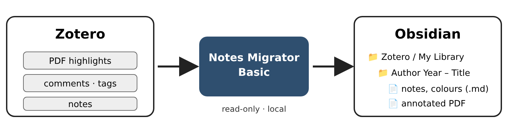
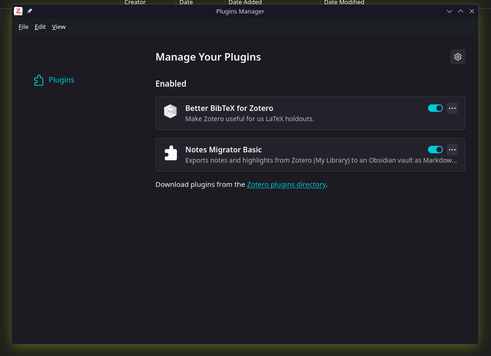
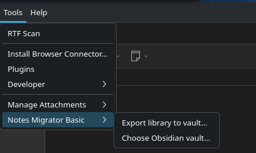
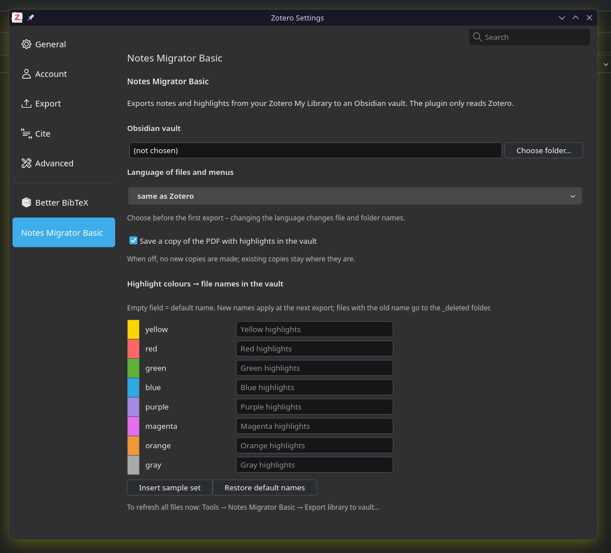
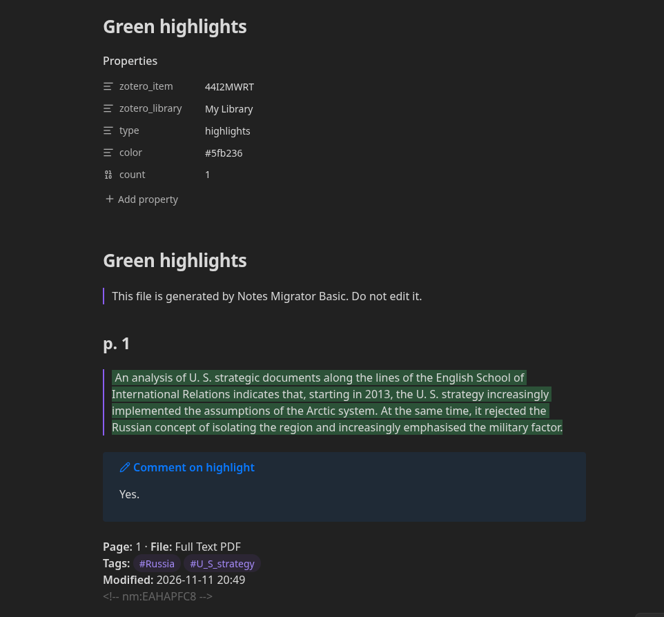

# Notes Migrator Basic

**[Polski → README.pl.md](README.pl.md)**

A Zotero plugin that copies your **notes and PDF highlights** from Zotero into an **Obsidian vault** as plain
Markdown files – one folder per source, one file per note, one file per highlight colour. Files update by themselves
a few seconds after you change something in Zotero.



- **Read-only for Zotero** – the plugin never changes your Zotero library.
- **Local only** – nothing is sent to the internet; files are written only to your vault.
- **My Library only** – group libraries are skipped.
- **Polish and English** – menus, file names and Markdown headings follow your choice (or Zotero's language).
- **Your own colour system** – name each of the eight Zotero highlight colours (e.g. green = “Agree”).
- **Optional annotated PDF** – a copy of the PDF with highlights burned in, readable in any PDF viewer.

## Requirements

| Program | Version |
|---|---|
| [Zotero](https://www.zotero.org/) | 7 or newer (tested up to 10) |
| [Obsidian](https://obsidian.md/) | any; 1.14 or newer shows highlights in colour |

Windows, macOS and Linux.

## Installation

1. **Create a vault in Obsidian** (*Create new vault*) and remember where you saved it. A vault is an ordinary folder.
2. **Download** `notes-migrator-basic-x.y.z.xpi` from [Releases](https://github.com/belferIR/notes-migrator-basic/releases)
   (right-click → *Save link as…*; Firefox users: do not open it in the browser).
3. In Zotero: **Tools → Plugins** → gear icon ⚙ → **Install Plugin From File…** → choose the `.xpi` file.

   
4. **Choose your vault:** **Tools → Notes Migrator Basic → Choose Obsidian vault…** and select the vault folder itself.
5. **First export:** **Tools → Notes Migrator Basic → Export library to vault…** From now on the plugin works on its own.

   

Updates: Zotero checks for new versions automatically (**Tools → Plugins → ⚙ → Check for Updates**).

## Settings

**Edit → Settings → Notes Migrator Basic** (macOS: **Zotero → Settings**).



| Setting | What it does |
|---|---|
| Obsidian vault | the folder where files are written |
| Language | *same as Zotero*, Polish or English – choose it **before the first export** (it changes file and folder names) |
| Annotated PDF copy | on/off; when off, no new copies are made and existing copies stay |
| Highlight colours → file names | your name for each colour; empty = default (“Green highlights”); **Insert sample set** fills in an example system |

Sample colour system (“Insert sample set”):

| Colour in Zotero | File in the vault |
|---|---|
| green | Agree.md |
| red | Disagree.md |
| yellow | Interesting point.md |
| blue | See another author.md |
| orange | Definitions.md |
| magenta | What does this mean.md |
| purple, gray | Purple highlights.md, Gray highlights.md |

## What you get in the vault

```
Your vault/
└── Zotero/
    └── My Library/
        └── Smith 2020 – Arctic security [AB12CD34]/
            ├── _record.md                         source details
            ├── Note – 2026-11-10 10-05 [XY..].md  one file per note
            ├── Agree.md                           all highlights of one colour
            ├── Definitions.md
            ├── Annotated PDF – … .pdf             optional
            └── My notes.md                        ← YOUR file (create it yourself)
```


Each highlight file lists the quote (highlighted in its colour), page number, your comment and tags.



> **Do not edit files created by the plugin** – they are overwritten at the next change in Zotero.
> Write your own thoughts in separate files (e.g. `My notes.md` in the source folder). The plugin never touches them.

Deleted notes and highlights are moved to `_deleted/` in the source folder; deleted Zotero items are moved to
`Zotero/_archive/`. Nothing disappears without a trace.

## Troubleshooting

| Problem | Solution |
|---|---|
| Nothing appears in the vault | Check the vault in Settings; run *Export library to vault…* |
| Notes from a group library are missing | By design: Basic exports My Library only |
| Quotes are not coloured | Update Obsidian to 1.14 or newer |
| A source folder was renamed | Normal after changing author, year or title in Zotero; the plugin recognises the folder by the key in [ ]; your own files move with it |
| Something else | Log file: `notes-migrator-basic.log` in the Zotero data directory (*Settings → Advanced → Files and Folders → Show Data Directory*). Please attach it to an [issue](https://github.com/belferIR/notes-migrator-basic/issues). |

**Uninstall:** Tools → Plugins → Notes Migrator Basic → Remove. Files in the vault stay.

## For developers

See [DEVELOPMENT.md](DEVELOPMENT.md). Changes: [CHANGELOG.md](CHANGELOG.md).

## Authorship

Author and maintainer: **belferIR**. The plugin was prepared with the help of the large language model
**Claude Opus 5.5** by Anthropic (model ID `claude-opus-5-5`), which wrote the code and documentation under the
author's direction; the author defined the requirements, tested the plugin and is responsible for its publication.

## Licence

Copyright © 2026 belferIR. [GNU General Public License v3.0 or later](LICENSE): you may use, change and share this
plugin; changed versions you distribute must remain under the GPL with source code.
