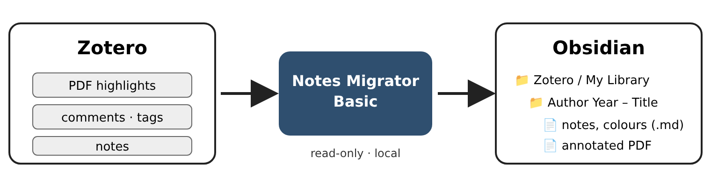
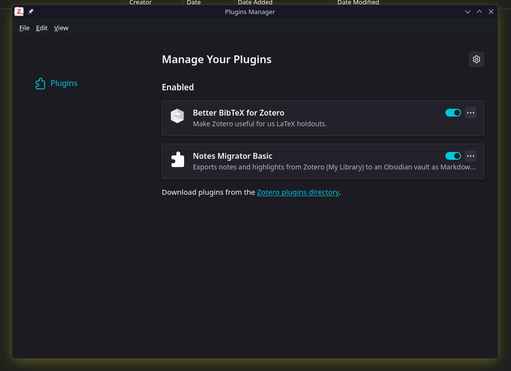
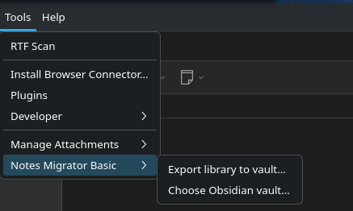
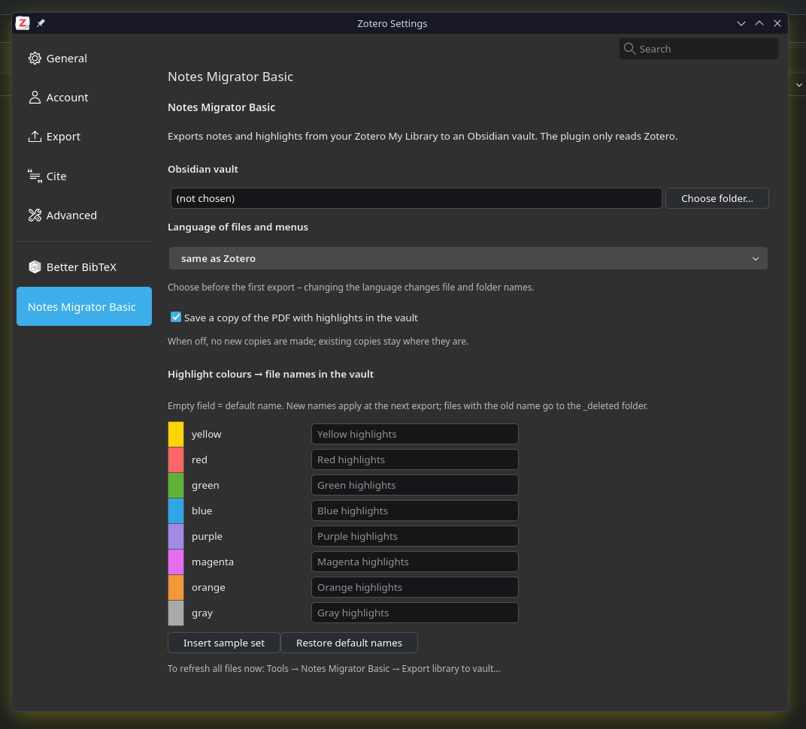
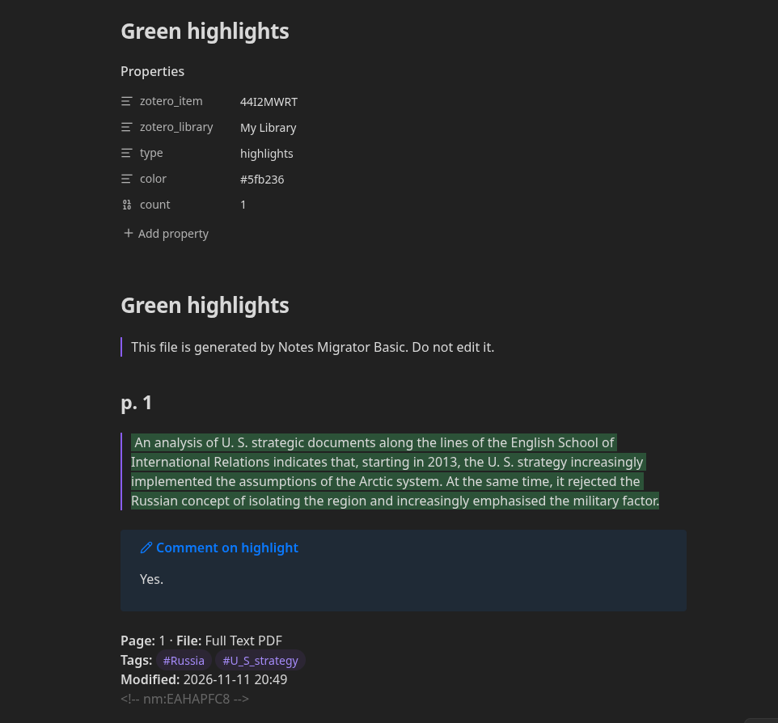

# Notes Migrator Basic

**[English → README.md](README.md)**

Wtyczka do Zotero, która kopiuje Twoje **notatki i zaznaczenia w PDF** z Zotero do **sejfu Obsidiana** jako zwykłe
pliki Markdown: osobny folder dla każdego źródła, osobny plik dla każdej notatki i każdego koloru zaznaczeń.
Pliki aktualizują się same kilka sekund po zmianie w Zotero.



- **Tylko czyta Zotero** – niczego nie zmienia w Twojej bibliotece.
- **Wszystko lokalnie** – nic nie trafia do internetu; pliki powstają tylko w Twoim sejfie.
- **Tylko Moja biblioteka** – biblioteki grupowe są pomijane.
- **Po polsku i po angielsku** – menu, nazwy plików i nagłówki według Twojego wyboru (albo języka Zotero).
- **Własny system kolorów** – każdemu z ośmiu kolorów Zotero nadajesz nazwę (np. zielony = „Zgadzam się”).
- **Kopia PDF z zaznaczeniami (opcjonalnie)** – czytelna w każdej przeglądarce PDF.

## Czego potrzebujesz

| Program | Wersja |
|---|---|
| [Zotero](https://www.zotero.org/) | 7 lub nowsza (sprawdzona do 10) |
| [Obsidian](https://obsidian.md/) | dowolna; od 1.14 zaznaczenia są kolorowe |

Windows, macOS i Linux.

## Instalacja

1. **Utwórz sejf w Obsidianie** (*Utwórz nowy sejf*) i zapamiętaj, gdzie go zapisałeś. Sejf to zwykły folder.
2. **Pobierz** plik `notes-migrator-basic-x.y.z.xpi` z zakładki [Releases](https://github.com/belferIR/notes-migrator-basic/releases)
   (prawy klik → *Zapisz link jako…*; w Firefoksie nie otwieraj go w przeglądarce).
3. W Zotero: **Narzędzia → Wtyczki** → ikona koła zębatego ⚙ → **Zainstaluj wtyczkę z pliku…** → wskaż plik `.xpi`.

   
4. **Wskaż sejf:** **Narzędzia → Notes Migrator Basic → Wybierz sejf Obsidian…** i wybierz sam folder sejfu.
5. **Pierwszy zapis:** **Narzędzia → Notes Migrator Basic → Zapisz bibliotekę do sejfu…** Od tej chwili wtyczka działa sama.

   

Aktualizacje: Zotero sam sprawdza nowe wersje (**Narzędzia → Wtyczki → ⚙ → Sprawdź aktualizacje**).

## Ustawienia

**Edycja → Ustawienia → Notes Migrator Basic** (macOS: **Zotero → Ustawienia**).



| Ustawienie | Co robi |
|---|---|
| Sejf Obsidian | folder, do którego trafiają pliki |
| Język | *jak Zotero*, polski albo angielski – wybierz **przed pierwszym zapisem** (zmienia nazwy plików i folderów) |
| Kopia PDF z zaznaczeniami | włączona/wyłączona; po wyłączeniu nowe kopie nie powstają, istniejące zostają |
| Kolory zaznaczeń → nazwy plików | własna nazwa dla każdego koloru; puste pole = nazwa domyślna („Zielone zaznaczenia”); **Wstaw przykładowy zestaw** wpisuje gotowy system |

Przykładowy zestaw („Wstaw przykładowy zestaw”):

| Kolor w Zotero | Plik w sejfie |
|---|---|
| zielony | Zgadzam się.md |
| czerwony | Nie zgadzam się.md |
| żółty | Interesująca uwaga autora.md |
| niebieski | Zobacz innego autora.md |
| pomarańczowy | Definicje.md |
| purpurowy | O co tutaj chodzi.md |
| fioletowy, szary | Fioletowe zaznaczenia.md, Szare zaznaczenia.md |

Na wydruku czarno-białym kolory są nierozróżnialne – kieruj się nazwą pliku.

## Co powstaje w sejfie

```
Twój sejf/
└── Zotero/
    └── Moja biblioteka/
        └── Kowalski 2020 – Polityka arktyczna [AB12CD34]/
            ├── _rekord.md                            opis źródła
            ├── Notatka – 2026-11-10 10-05 [XY..].md  jedna notatka = jeden plik
            ├── Zgadzam się.md                        zaznaczenia jednego koloru
            ├── Definicje.md
            ├── PDF z adnotacjami – … .pdf            opcjonalnie
            └── Moje.md                               ← TWÓJ plik (tworzysz sam)
```


Plik koloru zawiera cytat (podświetlony kolorem zaznaczenia), numer strony, Twój komentarz i tagi.



> **Nie edytuj plików utworzonych przez wtyczkę** – przy następnej zmianie w Zotero zostaną nadpisane.
> Własne przemyślenia zapisuj w osobnych plikach (np. `Moje.md` w folderze źródła). Takich plików wtyczka nie rusza.

Usunięte notatki i zaznaczenia trafiają do folderu `_usuniete/` w folderze źródła, a usunięte rekordy Zotero –
do `Zotero/_archiwum/`. Nic nie znika bez śladu.

## Problemy

| Sytuacja | Co zrobić |
|---|---|
| W sejfie nic nie powstaje | Sprawdź sejf w Ustawieniach; uruchom *Zapisz bibliotekę do sejfu…* |
| Brak notatek z biblioteki grupowej | Zamierzone: Basic zapisuje tylko Moją bibliotekę |
| Cytaty nie są kolorowe | Zaktualizuj Obsidian do 1.14 lub nowszego |
| Folder źródła zmienił nazwę | Normalne po zmianie autora, roku lub tytułu w Zotero; wtyczka rozpoznaje folder po kluczu w [ ]; Twoje pliki przechodzą razem z nim |
| Coś innego | Dziennik: `notes-migrator-basic.log` w katalogu danych Zotero (*Ustawienia → Zaawansowane → Pliki i foldery → Pokaż katalog danych*). Dołącz go do [zgłoszenia](https://github.com/belferIR/notes-migrator-basic/issues). |

**Odinstalowanie:** Narzędzia → Wtyczki → Notes Migrator Basic → Usuń. Pliki w sejfie zostają.

## Dla programistów

[DEVELOPMENT.md](DEVELOPMENT.md) (po angielsku). Zmiany: [CHANGELOG.md](CHANGELOG.md).

## Autorstwo

Autor i opiekun projektu: **belferIR**. Wtyczka została przygotowana przy użyciu dużego modelu językowego
**Claude Opus 5.5** firmy Anthropic (identyfikator modelu `claude-opus-5-5`), który napisał kod i dokumentację
według wskazań autora; autor określił wymagania, przetestował wtyczkę i odpowiada za jej publikację.

## Licencja

Copyright © 2026 belferIR. [GNU General Public License v3.0 lub nowsza](LICENSE): możesz używać, zmieniać i udostępniać
wtyczkę; rozpowszechniane zmienione wersje muszą pozostać na licencji GPL, razem z kodem źródłowym.
